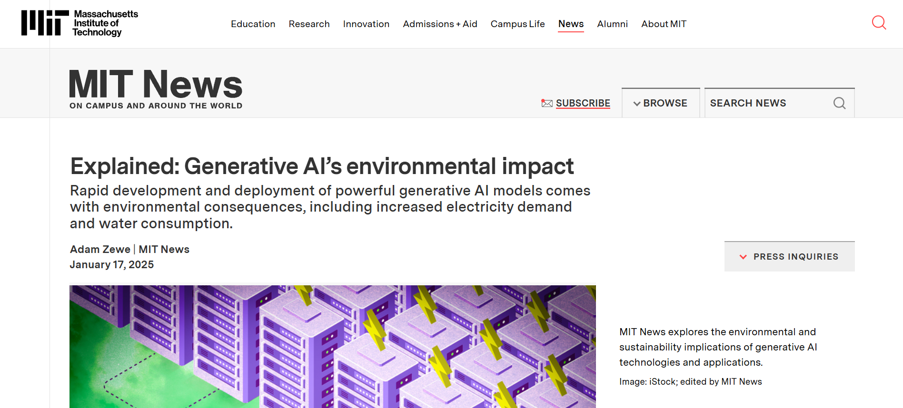
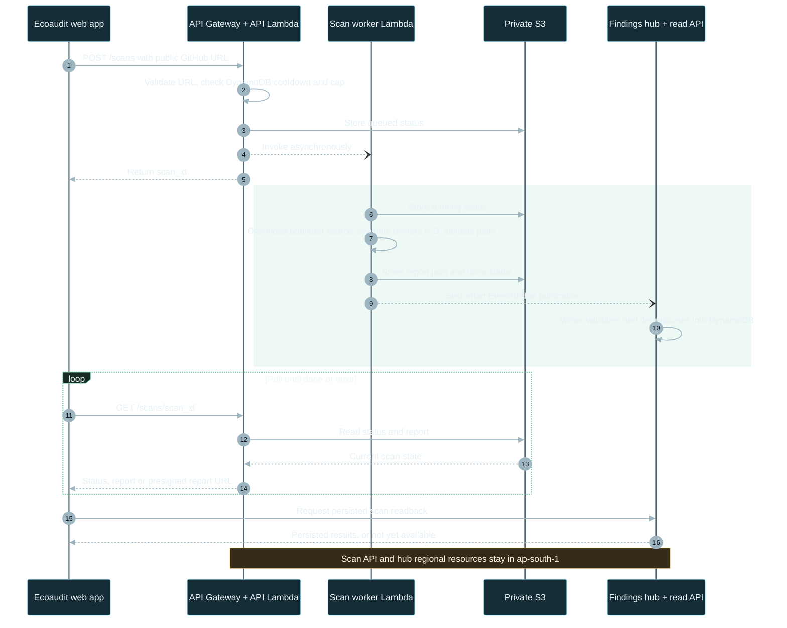

# Ecoaudit

**Live deployed app:** [Open Ecoaudit](https://main.dz3ac51z9uzpr.amplifyapp.com/)

[](https://news.mit.edu/2025/explained-generative-ai-environmental-impact-0117)

[Read the article: Explained — Generative AI’s environmental impact (MIT News)](https://news.mit.edu/2025/explained-generative-ai-environmental-impact-0117)

## Index

| Explore the product | Run and contribute |
| --- | --- |
| [About Ecoaudit](#about-ecoaudit) | [Getting started](#getting-started) |
| [How it works](#how-it-works) | [Repository layout](#repository-layout) |
| [Architecture](#architecture) | [Validation](#validation) |
| [Inside the app](#inside-the-app) | [Contributing](#contributing) |
| [Detectors and evidence](#detectors-and-evidence) | [Documentation](#documentation) |
| [Understanding results](#understanding-results) | [Project and license](#project-and-license) |
| [Environmental measurements](#environmental-measurements) | [Current boundaries](#current-boundaries) |

## About Ecoaudit

**Find avoidable compute waste. Inspect the evidence. Make a focused improvement.**

Ecoaudit is a software sustainability auditor. It examines source code and configuration, evaluates supported checks from a software compute-waste taxonomy, and turns the results into findings developers can investigate and share with their coding agents.

A healthy application can still waste resources through repeated queries, unnecessary allocations, serial network work, oversized builds or poorly timed jobs. Ecoaudit makes those patterns visible through cited evidence, detection confidence, recommendations and technical references.

The hosted repository scanner reads code without executing it. Optional connectors consume existing telemetry or artifacts produced in the client's own environment. Environmental measurements have their own provenance: a static finding alone never becomes a claim of carbon or energy savings.

## How it works



<details>
<summary>Diagram source (Mermaid)</summary>

<!-- The SVG preview above is generated from this source with htmlLabels: false.
     Keep the preview and source together when updating this diagram. -->

```text
flowchart LR
    repo("01 · Choose a repository<br/>Public GitHub URL or local checkout")
    collect("02 · Collect bounded inputs<br/>Source · configuration · metadata")
    checks("03 · Evaluate detectors<br/>Supported checks across four owners")
    validate("04 · Validate evidence<br/>Contract · identity · exact citations")
    report("05 · Explore the report<br/>Findings · coverage · limitations")
    improve("06 · Make a focused change<br/>Copy context to your coding agent")

    repo --> collect --> checks --> validate --> report --> improve

    classDef input fill:#142c35,stroke:#69b7ce,color:#eef8fc,stroke-width:2px;
    classDef process fill:#182b25,stroke:#75c6a1,color:#edf9f2,stroke-width:2px;
    classDef evidence fill:#282339,stroke:#b49be0,color:#f6f1ff,stroke-width:2px;
    classDef action fill:#332b18,stroke:#d6b46b,color:#fff6e2,stroke-width:2px;
    class repo,collect input;
    class checks process;
    class validate,report evidence;
    class improve action;
```

</details>

1. **Choose an input.** Paste a public GitHub repository into `/home`, or scan a directory with the CLI.
2. **Read supported files.** The scanner skips vendor/build directories, symlinks, binaries and oversized files; collection limits and omissions appear in the report.
3. **Evaluate the applicable checks.** Each detector states what it can evaluate and which evidence is missing.
4. **Validate before reporting.** Input/result pairs must satisfy the shared contract and cite the supplied evidence.
5. **Review and act.** Inspect the source location, recommendation and references. Copy a focused prompt for your own coding agent; Ecoaudit does not automatically modify the repository.

## Architecture

### Hosted repository scan

The implemented scan API uses **API Gateway, asynchronous Lambda invocation, S3 and DynamoDB**, with results published to the EventBridge findings hub. This diagram describes that path; the broader orchestration design is documented in [Architecture flows](docs/ARCHITECTURE_FLOWS.md).



- The web app is hosted on **AWS Amplify** and receives API base URLs at build time.
- The worker downloads a bounded repository archive, scans text, writes the report and deletes the temporary source.
- **Owners A and B require the Node.js runtime layer** in the Python worker. A missing runtime becomes an unavailable adapter.
- Hub publication is best-effort. A finished report remains usable if delivery fails; **readback**, rather than a successful event send, establishes persistence.
- Regional resources and integrations must stay in the selected project Region. Deployment instructions and current limits live in the component READMEs; merging code does not redeploy a Lambda.

### Evidence routes

Connectors acquire evidence; detectors evaluate it. A runtime-dependent check cannot be confirmed from a source-only scan.



<details>
<summary>Diagram source (Mermaid)</summary>

<!-- The SVG preview above is generated from this source with htmlLabels: false.
     Keep the preview and source together when updating this diagram. -->

```text
flowchart LR
    subgraph inputs["EVIDENCE SOURCES"]
        source("Repository files<br/>Code and configuration")
        artifacts("Client-produced artifacts<br/>Profiles · EXPLAIN · HAR · test/build reports")
        telemetry("Existing authorized telemetry<br/>CloudWatch · X-Ray · resource inventory")
    end

    normalize("Connectors and normalizers<br/>Snapshot identity · scope · acquisition bounds")
    detect("Check-specific evaluation<br/>Static pattern or supported runtime evidence")
    gate{"Valid contract pair<br/>and matching citations?"}
    accepted("Accepted result<br/>Findings · coverage · provenance")
    rejected("Explicit failure or limitation<br/>No invented evidence or clean claim")

    source --> normalize
    artifacts --> normalize
    telemetry --> normalize
    normalize --> detect --> gate
    gate -->|"Yes"| accepted
    gate -->|"No"| rejected

    classDef input fill:#142c35,stroke:#69b7ce,color:#eef8fc,stroke-width:2px;
    classDef compute fill:#182b25,stroke:#75c6a1,color:#edf9f2,stroke-width:2px;
    classDef gateStyle fill:#332b18,stroke:#d6b46b,color:#fff6e2,stroke-width:2px;
    classDef result fill:#282339,stroke:#b49be0,color:#f6f1ff,stroke-width:2px;
    classDef failure fill:#361f27,stroke:#d98c9e,color:#fff1f5,stroke-width:2px;
    class source,artifacts,telemetry input;
    class normalize,detect compute;
    class gate gateStyle;
    class accepted result;
    class rejected failure;
    style inputs fill:#0e191f,stroke:#365260,color:#e6f2f7
```

</details>

Pointer-based hub ingestion checks the allowlisted object, checksum, identity and input/result citations. Inline result events carry a weaker evidence label because the input is not supplied with the event. A hub's `verified` label describes contract and citation validation; it does not certify a production workload or measured savings. See [hub ingestion and readback](hub/README.md).

## Inside the app

| Page or tool | What it shows | Data basis |
| --- | --- | --- |
| `/` | Landing experience, clover identity and Continue navigation | Product introduction |
| `/home` | Repository input, scan progress and findings | Live configured scan API; no sample fallback when scanning is unconfigured |
| `/reports` | Overview, finding details, checks, provenance and browser-local scan history | Selected scan, persisted hub copy, imported report or explicitly labelled recorded sample |
| `/overview` | Audit activity, taxonomy distribution and evidence coverage | Isolated illustrative workspace figures; no device metrics or live scan substitution |
| `/environment` | Power, energy, modelled footprint and process activity from run-it | Opt-in local run-it session, or a labelled recorded session when none is available |
| `dashboard/index.html` | Lightweight viewer for CLI reports | A loaded `report.json` or bundled real scan sample; no build step |

The particle pipeline shown during analysis is a visual illustration. The scan's status, result and error state come from the API. Particle stages are not live AWS service telemetry.

Reports can be exported as JSON. Local report imports stay in the browser, and browser history retains up to 12 scans. See [frontend configuration and report behavior](web/README.md).

## Detectors and evidence

The [taxonomy](docs/taxonomy/README.md) defines **251 checks**. That is the catalog size, not a claim that every check is implemented or supported by a public repository scan. The report identifies the checks actually attempted and their coverage.

| Package | Focus | Evidence and interfaces |
| --- | --- | --- |
| [Owner A](detectors/owner-a/README.md) | Code efficiency, loops, data structures, allocations and resource handling | Python static analysis with tree-sitter; supported client allocation artifacts |
| [Owner B](detectors/owner-b/README.md) | Database access, ORM patterns, network/API/serialization and background jobs | Source checks plus [query evidence](detectors/owner-b/README.md#hybrid-evidence), [job evidence](detectors/owner-b/JOBS.md), [network captures](detectors/owner-b/NETWORK.md) and EXPLAIN artifacts |
| [Owner C](detectors/owner-c/README.md) | Python, JavaScript/TypeScript, frontend and CI efficiency | Source/config analysis, normalized profiles, build/browser artifacts and CI history |
| [Owner D](detectors/owner-d/README.md) | Infrastructure, observability, tests and LLM runtime operations | Static configuration, authorized existing telemetry and client artifacts |

Availability is check-specific. The public repository adapter supports only a subset of each package's full interfaces: for example, registered Owner B network and EXPLAIN checks remain unavailable without their required captures. Per-check specifications, research decisions and fixtures describe supported formats, legitimate exceptions and false-positive controls.

## Understanding results

Each finding provides a check ID, semantic fingerprint, exact evidence, confidence, recommendation and technical references. Where source is available, reports include the file and line plus a copyable prompt for a targeted fix.

| Status | Meaning |
| --- | --- |
| `completed` | All requested scope was evaluated under the check's evidence requirements; inspect findings and limitations |
| `partial` | Some requested scope was evaluated; omissions are explained |
| `unavailable` | Required evidence, runtime or format support was missing |
| `error` | Evaluation or validation failed |
| `not_applicable` | The scanner collected no files that this check examines |

**Unavailable, failed and not-applicable checks are not passes.** High confidence describes confidence in a detection, not the size of a saving or a guarantee that the suggested change is appropriate. Static candidates require runtime evidence where the check's specification calls for it.

Stable fingerprints help track findings when lines move. The shared comparison logic only classifies disappearance as `no_longer_detected` under compatible complete coverage, detector versions, context and scope. A changed scan boundary cannot establish that an issue was fixed. See the [detector contract](docs/DETECTOR_CONTRACT.md).

## Environmental measurements

Repository-only reports explicitly use **`impact.status = not_quantified`**. Finding counts do not determine watts, CO₂e, water use or savings.

[run-it](run_it/README.md) is a separate, opt-in local tool. It can observe current-user processes or launch a command you choose, measure its process tree where supported, and expose live state to `/environment` through a loopback-only endpoint.



<details>
<summary>Diagram source (Mermaid)</summary>

<!-- The SVG preview above is generated from this source with htmlLabels: false.
     Keep the preview and source together when updating this diagram. -->

```text
flowchart LR
    local("Your local run-it session<br/>Watch processes or run a chosen command")
    counters("macOS energy counters<br/>Measured joules and power")
    model("Documented conversion factors<br/>Modelled CO2e and water")
    view("Local terminal and /environment<br/>Measurements · sources · limitations")
    files("Read-only folder scan<br/>Separate static findings")

    local --> counters
    counters --> view
    counters --> model --> view
    local --> files --> view

    classDef localStyle fill:#142c35,stroke:#69b7ce,color:#eef8fc,stroke-width:2px;
    classDef measured fill:#182b25,stroke:#75c6a1,color:#edf9f2,stroke-width:2px;
    classDef modelled fill:#332b18,stroke:#d6b46b,color:#fff6e2,stroke-width:2px;
    classDef output fill:#282339,stroke:#b49be0,color:#f6f1ff,stroke-width:2px;
    class local,files localStyle;
    class counters measured;
    class model modelled;
    class view output;
```

</details>

- Process energy measurement currently requires **macOS**. Other platforms show energy as unavailable while supported process and scanner views remain usable.
- CO₂e and water are **modelled** from energy and documented factors; overrides and provenance are labelled. Water currently covers electricity generation rather than data-centre cooling.
- Process measurements and code findings remain separate. The tool does not attribute a measured carbon total to individual source lines.
- The repository report describes a planned Software Carbon Intensity methodology; its embodied-emissions and functional-unit inputs are not a completed repository estimator.

For collector behavior, factors, platform limits and loopback access rules, read [run_it/README.md](run_it/README.md).

## Getting started

### Prerequisites

Use **Python 3.12+**, **Node.js 22** (see [`.nvmrc`](.nvmrc)), npm and Git. Install dependencies in this repository; the scanner never installs the repository it is inspecting.

### Run the web app

```bash
cd web
npm ci
cp .env.example .env.local
# Set the API URLs in .env.local before starting or building.
npm run dev
```

Open [localhost:3000](http://localhost:3000). On Windows, use `Copy-Item .env.example .env.local` in PowerShell.

| Build-time variable | Purpose |
| --- | --- |
| `NEXT_PUBLIC_SCAN_API_URL` | Base URL for `POST /scans` and `GET /scans/{scan_id}` |
| `NEXT_PUBLIC_HUB_API_URL` | Base URL for persisted public scan readback |

These public API base URLs are inlined at build time. An unset scan URL produces a configuration message; an unset hub URL leaves the scan report usable without hub readback. See [web setup](web/README.md#configuration).

### Run the scanner locally

From the repository root:

```bash
python3 -m venv .venv
.venv/bin/python -m pip install -r shared/contracts/requirements.txt -r detectors/owner-c/requirements.txt
npm ci
npm --prefix detectors/owner-a ci
npm --prefix detectors/owner-a run build

.venv/bin/python -m scanner scan https://github.com/pallets/itsdangerous -o report.json
.venv/bin/python -m scanner scan path/to/repository -o report.json --owners C,D
```

On Windows, create the environment with `py -3.12 -m venv .venv` and use `.venv\Scripts\python.exe` for the Python commands. No AWS credentials are required for a local source-only scan. Open the resulting report through `/reports` → **Open report.json**, or use [the standalone dashboard](dashboard/index.html).

### Run the local energy monitor

After the scanner dependencies are installed:

```bash
.venv/bin/python -m pip install -r run_it/requirements.txt
.venv/bin/python -m run_it
# Optional: launch and measure a command you choose.
.venv/bin/python -m run_it -- npm run build
```

The module commands above run from this checkout. On macOS/Linux, link `scripts/run-it` into a directory on your PATH to use `run-it` from another project folder; the wrapper locates this checkout's environment. The live endpoint defaults to `http://127.0.0.1:47321/state`; `--no-serve` disables it. Measurement support and browser access limitations are documented in [run-it](run_it/README.md).

## Current boundaries

- Hosted scans accept **public GitHub repositories at default-branch HEAD**. Private-repository OAuth, a general authenticated account workflow and the full scheduled estimation architecture are not established by the current source-scan API.
- The collector defaults to **5,000 files and 1 MB per file**, with exclusions recorded in the report. Submodules are not included in hosted archives; LFS objects may arrive as pointers.
- Missing profiles, query events, HTTP captures, telemetry, dependencies or supported syntax remain visible as limitations.
- The public scan API is unauthenticated and uses throttling, concurrency limits, cooldowns and a daily cap. CORS controls browser access, not authentication. See [scan API limits](infra/scan-api/README.md#limitations).
- Independent detector connectors and target architecture documents describe capabilities beyond the single source-scan path. Inspect their configuration and evidence requirements before treating a check as operational.
- The separate [Lighthouse worker](lighthouse-worker/README.md) actively loads a supplied website URL in Chromium. It performs a browser audit and can save JSON/HTML reports privately to S3; it is outside the repository scanner's non-execution boundary.
- Measured, modelled, illustrative and static data retain their distinct labels. Unsupported impact values stay unquantified.

## Repository layout

```text
web/                     Next.js app, particle UI, reports and environment view
dashboard/               Standalone report viewer
scanner/                 Bounded source collection, owner adapters and report generation
scan_api/                Async HTTP API, worker, report storage and scan guard
detectors/owner-{a,b,c,d}/ Check implementations, specifications, connectors and tests
shared/contracts/        JSON Schema, evidence validation and compatible scan comparison
hub/                     Findings ingestion, persistence, readback and artifact upload
run_it/                  Local process/energy monitor and loopback state server
lighthouse-worker/       Optional browser audit service with private report storage
infra/                   Scan API and Owner B infrastructure
cdk/                     Per-owner CloudFormation templates
scripts/                 Build, packaging, deployment checks and taxonomy helpers
tests/                   Contract, scanner, API and run-it regression suites
docs/                    Product scope, architecture, research, taxonomy and verification
.github/                 Issue forms, PR template, workflows and client collector action
```

## Validation

Run the checks relevant to your change. CI is defined in [`.github/workflows/ci.yml`](.github/workflows/ci.yml); the frontend has its own lint/build commands.

```bash
# Shared contract and scanner/API regression suites, from the repo root.
.venv/bin/python -m shared.contracts.verify
.venv/bin/python -m unittest discover -s tests/scanner
.venv/bin/python -m unittest discover -s tests/scan_api

# Owner B/root tooling.
npm run lint
npm run typecheck
npm test

# Owner A and the frontend.
npm --prefix detectors/owner-a run typecheck
npm --prefix detectors/owner-a test
npm --prefix web run lint
npm --prefix web run build
```

Other suites cover Owner C, Owner D, the findings hub and run-it. Use their component READMEs for dependency and `PYTHONPATH` instructions. Synthetic fixtures establish detector behavior; they do not certify customer runtime waste.

## Contributing

Follow **issue → branch → commit → rebase → PR → review → squash-merge**. One issue per PR, no direct pushes to `main`, no merge commits on feature branches and no fabricated verification or reviewer approval.

```bash
git fetch upstream
git switch -c 42-docs-clearer-readme upstream/main
# Make and verify one focused change.
git add README.md
git commit -m "#42 | docs(readme): clarify setup"
git fetch upstream
git rebase upstream/main
git push -u origin 42-docs-clearer-readme
# Open an upstream PR using the repository template and link exactly one issue.
```

Read [Contributing](CONTRIBUTING.md), [Workflow](docs/WORKFLOW.md), [Branching](docs/BRANCHING.md) and the [Code of Conduct](CODE_OF_CONDUCT.md). Detector work also needs a [verification plan](docs/VERIFICATION_PLAN.md) and the [shared contract](docs/DETECTOR_CONTRACT.md).

AWS work follows [the agent workflow](docs/AWS_AGENT_WORKFLOW.md): verify authorization, local profile identity and the selected Region before inspecting or changing resources. Keep raw AWS identities, credentials and private deployment receipts out of public commits.

## Documentation

| Reference | Use it for |
| --- | --- |
| [Product scope](docs/read_only_software_sustainability_auditor.md) | Auditor principles, supported evidence and environmental reporting rules |
| [Architecture flows](docs/ARCHITECTURE_FLOWS.md) | Broader target user, platform and AWS architecture |
| [Taxonomy](docs/taxonomy/README.md) | Check catalog, ownership and issue mapping |
| [Detector contract](docs/DETECTOR_CONTRACT.md) | Identity, exact citations, coverage, measurements and comparison |
| [Frontend](web/README.md) | API configuration, scan/report flows and illustrative UI behavior |
| [Scan API](infra/scan-api/README.md) | Endpoints, runtime packaging, bounds, deployment and cleanup |
| [Findings hub](hub/README.md) | Ingestion, validation levels, readback and artifact uploads |
| [run-it](run_it/README.md) | Local measurement sources, factors and platform support |
| [Lighthouse worker](lighthouse-worker/README.md) | Active browser audits and private JSON/HTML reports |
| [AWS service mapping](docs/aws_service_mapping_v1.6.md) | Taxonomy-to-service design rationale |
| [Research](docs/research/) and [verification](docs/verification/) | Decisions, test evidence and explicit acceptance limits |

## Project and license

Built for the **WeMakeDevs × AWS Environmental Hacks** hackathon, with a focus on avoidable software compute waste.

[Hackathon](https://www.wemakedevs.org/aws/env) · [Rules](https://www.wemakedevs.org/aws/env/rules) · [AWS Builder Center](https://builder.aws.com)

The project is licensed under [MIT](LICENSE). The linked article and screenshot are credited to MIT News; the illustration shown in the screenshot is credited to iStock, edited by MIT News. Third-party content retains its original rights.
